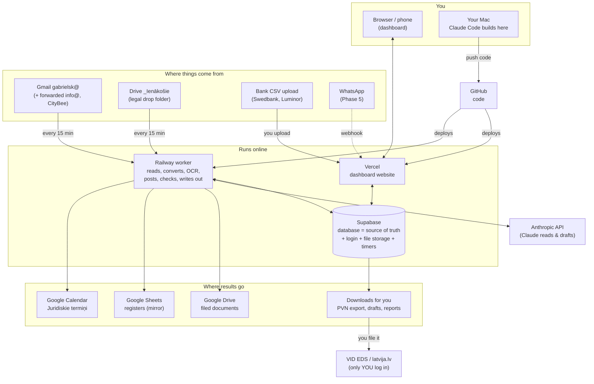
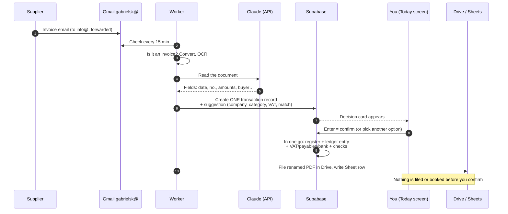
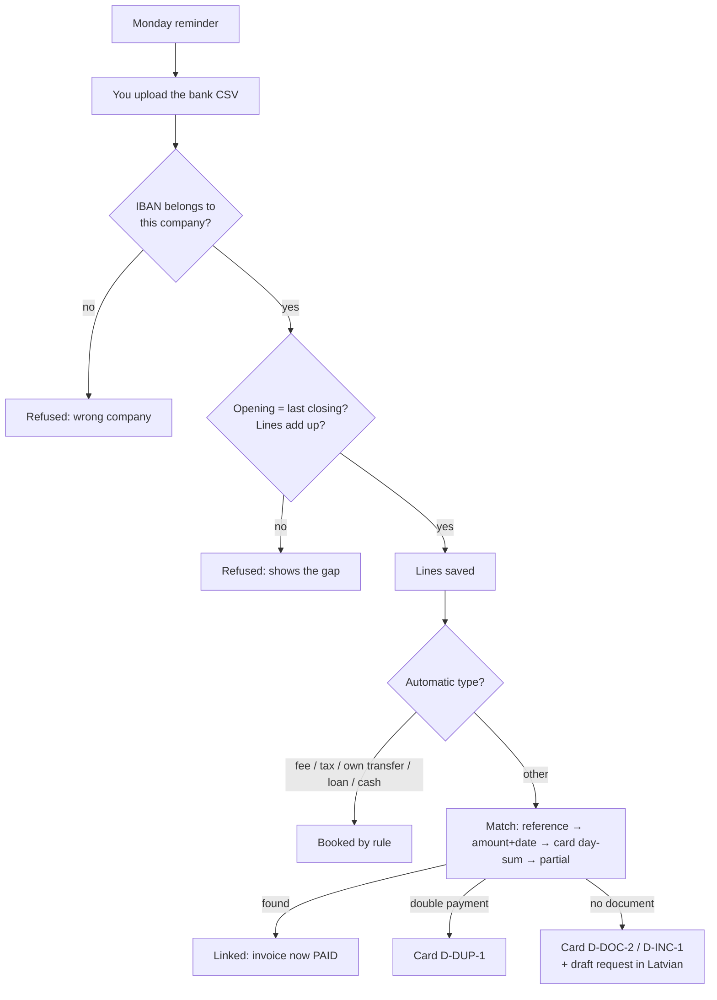
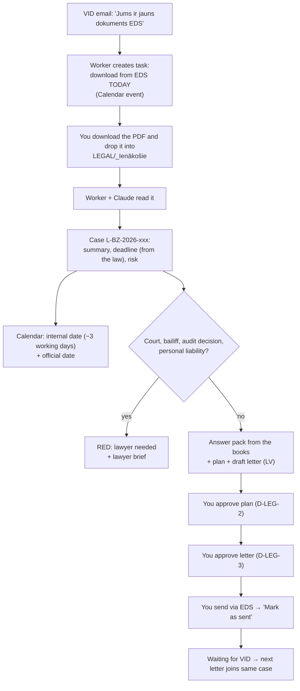
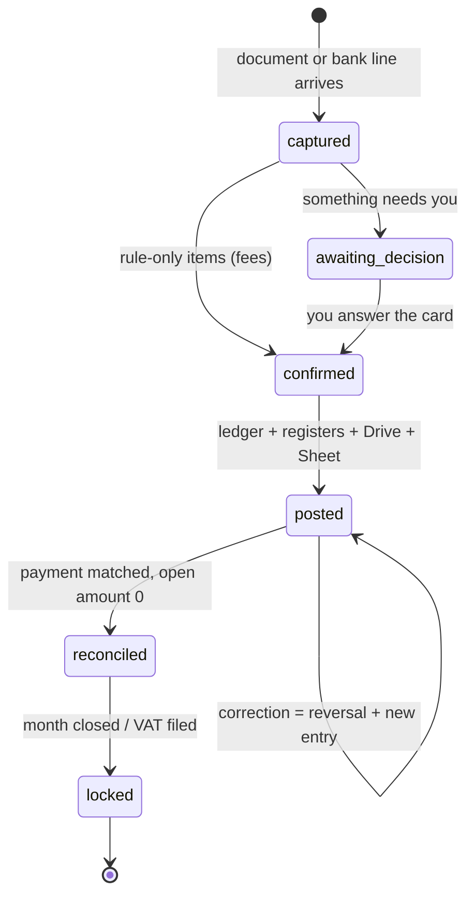
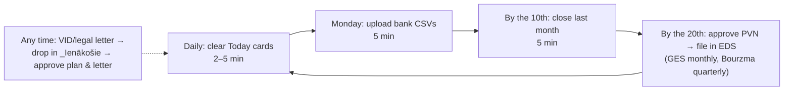

# Diagrams: how accounting-legal-panel is built and how it works

The diagrams are in Mermaid. GitHub shows them as pictures, and Claude Code can read them.

## 1. The parts and who talks to whom

**In words:**
- **Supabase is the heart.** Every fact lives there.
- **The website (Vercel)** shows and edits that data.
- **The worker (Railway)** does the heavy lifting. It reads mail and files, asks Claude to read documents, writes the books, and copies the results out to Drive, Sheets and Calendar.
- **Nothing goes to VID by itself.** You download the export and file it in EDS.

## 2. An invoice from arrival to the books

## 3. Bank statement → matching

## 4. A letter from VID (legal part)

## 5. The life of one transaction record

## 6. Your month at a glance

